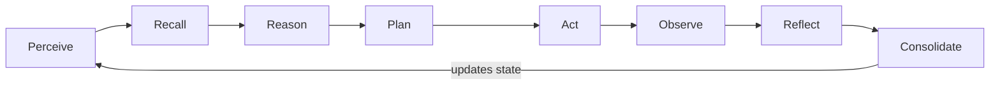

# AI Is Not Human: How Agents Create the Illusion of Thinking

> **Core thesis:** LLMs do not think like humans. They calculate probable continuations. Agents start to look intelligent when that calculation is wrapped in a loop: memory, tools, feedback, reflection, policy, and identity. The "brain" of an agent is not only the model. It is the whole operating system around the model.

## TL;DR

- A human brain is not a prompt processor. It is embodied, parallel, adaptive, emotional, social, and continuously rewired by experience.
- Conscious perception feels mostly 3D, but the machinery below awareness can be modelled with much richer topological structure. The "11 dimensions" claim is mathematical, not a claim that humans secretly see hyperspace after lunch.
- An LLM is not a tiny person trapped in a GPU. It predicts tokens using learned statistical structure.
- An agent creates the illusion of thinking by running a loop: perceive, recall, reason, plan, act, observe, reflect, consolidate.
- Hallucination is not just "wrong text". It is `cognitive-state instability` caused by missing context, stale memory, weak verification, bad tools, or unsafe feedback loops.
- Memory improves accuracy because it constrains the reasoning space. It improves speed because it stops the agent from re-solving yesterday's problem with today's expensive tokens.
- `SOUL.md` is the missing identity layer: a versioned, reviewable declaration of mission, tone, moral boundaries, tool authority, memory contract, and behavioural character.
- Until AGI arrives, the most dangerous part of the system is still usually the human or organisation that gives a probabilistic machine authority without enough boundaries.

The earlier articles covered [why tokens are real operating cost](../tokens-are-not-free/), [why agentic memory is not a vector database](../agent_memory/), [how to score governed memory](../agent_memory_calcs/), and [what human teams teach us about shared memory](../human_agent_memory/). This article is the bridge between them.

It asks a more uncomfortable question:

```text
If the model is only predicting tokens,
why does the agent sometimes feel like it is thinking?
```

The answer is not magic. It is architecture.

## The metaphor is useful until it starts lying

The brain-computer metaphor has been around for a long time. Von Neumann's _The Computer and the Brain_ helped frame early comparisons between natural and artificial computation. Later work kept returning to the same tension: computer science and neuroscience are deeply entangled, but the metaphor becomes dangerous when we forget that a metaphor is a tool, not a fact.

Baria and Cross make that point sharply in their paper on the computational metaphor. Calling the brain a computer and the computer a brain is not neutral language. It changes how society talks about intelligence, responsibility, bias, agency, and harm.

That warning matters for agent architecture.

If we say "the model thinks", we quietly move responsibility into the machine. If we say "the agent has a brain", we may forget that the brain was assembled by engineers, policy authors, data owners, workflow designers, and budget holders. The system did not wander into production by itself. Someone gave it tools, credentials, memory, and a deployment path.

So this article uses the word "brain" carefully.

An agent brain is not a biological brain. It is a constructed cognitive architecture. It has parts that rhyme with human cognition: memory, attention, feedback, reflection, habit, identity, and boundaries. But the substrate is different, the failure modes are different, and the moral responsibility stays with the humans operating it.

## Human cognition is not prompt completion

A human does not read a prompt, generate a response, and vanish.

We live inside a continuous loop of body, memory, world, and society. The brain runs massively parallel processing across billions of neurons. It maintains homeostasis, attention, emotion, sensory grounding, motor feedback, memory consolidation, prediction, social inference, and self-models at the same time. Learning is not a new paragraph appended to a transcript. Learning physically changes the system.

That matters.

Consciously, we mostly experience the world as three-dimensional space moving through time. Cups are on tables. Doors are behind us. Dashboards are on the second monitor because the first monitor is already full of yesterday's mistakes. But the brain does not have to use that same simple geometry internally. The Frontiers paper, later popularised by ScienceAlert, describes neural cliques and cavities that can be represented in dimensions far beyond our everyday 3D intuition, with some reported structures reaching up to 11 mathematical dimensions.

This is not eleven spatial dimensions. Nobody is claiming the subconscious is running a private sci-fi universe behind the eyes. The point is more useful than that: conscious perception is a compressed interface, while the underlying neural organisation can be high-dimensional, directed, and dynamic.

When a human engineer sees a production alert, the response is not only text completion:

- the smell of the last outage comes back
- the dashboard pattern feels familiar
- the team topology is remembered
- the rollback risk is felt
- the customer impact is prioritised
- the hands already know which terminal to open

The brain is not just storing facts. It is maintaining a lived, embodied model of the world.

Modern network neuroscience keeps reminding us how poor a simple machine metaphor can be. Reimann, Markram, Hess, and their colleagues used algebraic topology on reconstructed neocortical microcircuitry and found directed cliques and cavities that link structure with emergent function. The important bit for us is not the glamour of the mathematics. It is the shape of the claim: neural processing is directed, high-dimensional, time-evolving, and tied to activity patterns.

Even graph models of the brain are often too simple because real neural processing is not only neat pairwise edges. It includes higher-order structures, changing functional relationships, and direction of information flow. The brain is not a tidy entity-relation diagram. It is a wet, noisy, plastic, highly parallel survival machine with terrifying uptime.

An LLM has none of that by default.

It has no body. No stable self. No private memory unless memory is supplied. No direct pain when a deployment fails. No coffee-stained notebook from the last incident. No shame, no pride, no career-limiting memory of deleting the wrong namespace at 2 AM.

And yet, with the right wrapper, it can still perform useful work.

That wrapper is where agents begin.

## The model is a mathematical engine, not a mind

At the core, an autoregressive language model does something like this:

```text
Given:
    previous tokens t1...t(n-1)
    model parameters theta

Estimate:
    P(tn | t1...t(n-1), theta)

Choose:
    the next token, then repeat
```

In less polite language:

```text
Very expensive autocomplete,
trained on enough text that autocomplete sometimes looks like reasoning.
```

That sounds dismissive, but it should not. The mathematics is powerful. Transformers use attention to relate tokens across context. Training compresses patterns from huge corpora into model weights. Optimisation, calculus, linear algebra, probability, and massive hardware turn text into a function that can generate useful continuations across coding, planning, translation, summarisation, analysis, and tool use.

Still, prediction is not the same thing as human understanding.

A model can produce:

- an explanation of a Kubernetes failure
- a recovery plan
- a fake command that looks painfully real
- a citation that never existed
- a confident apology for a mistake it did not remember making

All of these are token sequences. Some are useful. Some are nonsense wearing a blazer.

The difference is not whether the prose sounds smart. The difference is whether the generated sequence is grounded, checked, constrained, and corrected.

That is the agent problem.

## Why the illusion of thinking works

A standalone LLM does not have durable cognition. But an agent is not only an LLM. An agent is a control system around an LLM.

The simplest useful shape looks like this:

```text
User or event
    -> perception
    -> memory recall
    -> model reasoning
    -> plan selection
    -> tool action
    -> observation
    -> reflection
    -> memory consolidation
    -> next action
```

The moment we add tools, the model's tokens can change the world. The moment we add memory, the next run is shaped by the previous run. The moment we add reflection, failure can become correction. The moment we add policy, plausible but unsafe actions can be blocked.

The agent looks like it is thinking because the loop has properties the model alone does not have:

- continuity across sessions
- task state
- external observation
- corrective feedback
- tool-grounded action
- durable memory
- policy constraints
- identity and role stability

None of this requires consciousness. A thermostat is not conscious either, but it is still a control loop. Agents are richer control loops with a probabilistic language engine at the centre and far more interesting ways to embarrass the team.

## The agentic brain loop

Here is the loop I find most useful. It is circular; the linear reading order is only one pass through the cycle:



Each stage controls a different failure mode, and the output of one cycle becomes part of the input state for the next cycle. In memory terms, the loop is easier to read as a contract:

| Stage       | What happens                                                                                                                                                                      | Memory meaning                                                                                                                                                                                                                | If this stage is weak                                                                                                                                         |
| ----------- | --------------------------------------------------------------------------------------------------------------------------------------------------------------------------------- | ----------------------------------------------------------------------------------------------------------------------------------------------------------------------------------------------------------------------------- | ------------------------------------------------------------------------------------------------------------------------------------------------------------- |
| Perceive    | The agent receives a prompt, event, tool result, file diff, alert, schedule trigger, or message. This is not human perception; it is a narrow input channel.                      | Memory types in play: working memory and temporal metadata. The stage opens or updates working memory with raw signal, source, timestamp, scope, and task boundary. Nothing should become durable truth yet.                  | Missing signals stay invisible. Bad source context contaminates the rest of the loop.                                                                         |
| Recall      | The agent retrieves working, episodic, semantic, procedural, identity, policy, and operational memory. This is where [managed memory](../agent_memory/) matters.                  | Memory types in play: semantic, episodic, procedural, identity, policy, operational, and temporal graph memory. This is the governed read path for facts, prior episodes, procedures, authority, time, scope, and provenance. | Similar chunks masquerade as relevant truth. The model gets context, but not necessarily grounding.                                                           |
| Reason      | The model generates hypotheses and candidate explanations. This is still token prediction, but now the prediction is constrained by retrieved state and task context.             | Memory types in play: working memory plus retrieved semantic, episodic, and graph evidence. Candidate beliefs stay temporary until checked.                                                                                   | Unsupported guesses become polished reasoning. The answer sounds coherent before it is grounded.                                                              |
| Plan        | The agent chooses an action sequence: tool order, files to inspect, approvals, reversibility, and stopping conditions.                                                            | Memory types in play: procedural, policy, operational, identity, and temporal memory. These decide what is allowed, what has worked, what is risky, what is stale, and what fits the agent's role.                            | The agent chooses a valid-looking plan that violates local process, safety, or authority boundaries.                                                          |
| Act         | The agent calls tools, runs commands, edits files, queries APIs, creates work items, opens pull requests, or sends messages. This is where toy demos become production risk.      | Memory types in play: policy, procedural, operational, and working memory. Tool calls carry scope, authority, intended state change, and the procedure being followed.                                                        | Text becomes authority without an evidence trail. The system acts on imagined state.                                                                          |
| Observe     | The environment answers back: command failed, test passed, API returned an empty list, reviewer objected, or the user corrected the premise.                                      | Memory types in play: working memory first, then episodic and operational memory candidates. Tool results and human feedback enter as evidence, not final truth.                                                              | The model invents tool outcomes instead of reading reality. That is where many operational hallucinations start.                                              |
| Reflect     | The agent compares expected outcome with actual outcome. It can critique its own plan, retry, call a verifier, ask another model, run tests, or stop for approval.                | Memory types in play: episodic, operational, policy, procedural, and temporal contradiction records. Reflection compares plan, observation, tests, acceptance criteria, and authority.                                        | Failures repeat because nothing turns error into correction. The agent becomes a very polite loop of the same mistake.                                        |
| Consolidate | The system decides what should become durable memory. A useful lesson becomes a procedure. A failed assumption becomes a warning. A repeated preference becomes identity context. | Memory types in play: semantic, episodic, procedural, identity, policy, operational, and temporal graph memory. The gated write path promotes verified records and expires, weakens, or contradicts stale ones.               | A hallucination, if written without checks, becomes tomorrow's "known fact". Bad memory does not reduce hallucination; it gives hallucination a pension plan. |

The loop can be expressed as a state-transition equation:

$$
S_{t+1} =
\mathcal{C}\left(
S_t,\,
O_t,\,
Y_t,\,
A_t,\,
\tau_t,\,
\Pi_t
\right)
$$

<div class="math-symbol-map" markdown="1">

$$
\small
\begin{array}{rcl}
S_{t+1} & = & \text{next agent state after observation, reflection, and consolidation} \\
\mathcal{C} & = & \text{consolidation function: governed write and update path} \\
S_t & = & \text{current agent state: context, memory, plan, confidence, assumptions} \\
O_t & = & \text{observation: tool output, test result, API response, human correction} \\
Y_t & = & \text{outcome: success, failure, partial success, or new risk} \\
A_t & = & \text{authority: confirmed, verified, approved, speculative, stale, or low trust} \\
\tau_t & = & \text{time context: recency, validity window, expiry, and ordering} \\
\Pi_t & = & \text{policy boundary: permissions, safety, privacy, approvals, identity rules}
\end{array}
$$

</div>

In plain English: the agent's next state is produced by a consolidation function. It takes the current state, the latest observation, the outcome of the action, the authority of the evidence, the time context, and the active policy boundary. Then it decides what changes: working context, durable memory, confidence, contradictions, procedures, or refusal boundaries.

**That is the practical shape of agent cognition**: Not a soul. Not sentience. A state machine with a language model, memory, tools, feedback, and guardrails.

## Agent plays devil's advocate against itself

The better agent systems do not trust the first answer.

They run internal opposition:

```text
Draft answer
    -> critic checks assumptions
    -> verifier checks evidence
    -> policy checks authority
    -> tools check reality
    -> revised answer
```

This is where agent behaviour starts feeling less like autocomplete and more like thought. The system produces a candidate, attacks it, repairs it, and retries. Humans do this too. We sketch a plan, hear the inner voice say "that migration will ruin Saturday", and adjust. In a mature organisation, this survival instinct starts even earlier: by Wednesday morning, everyone has already developed a principled architectural objection to late-Friday changes.

The AI version is more mechanical:

- chain-of-thought and scratchpads structure intermediate reasoning
- self-consistency samples multiple reasoning paths
- critic models score candidate answers
- verifier models check claims against sources or tests
- tool calls ground the answer in current state
- retries explore alternate plans
- policies reject unsafe actions

There is no tiny philosopher inside the model. There is a loop that keeps asking:

```text
Is this prediction still valid after reality has had a vote?
```

That one question is a large part of practical intelligence.

For example, consider a coding agent asked to fix a failing deployment.

Its first prediction may be reasonable:

```text
The failure is probably a missing environment variable.
```

A weak agent stops there and writes a confident fix. A better agent lets reality vote. It reads the workflow log, sees the container build passed, notices the failure happened during database migration, recalls that the last rollback failed because the migration was not reversible, and checks the policy that production schema changes require approval.

The answer changes:

```text
Do not patch the environment variable.
Inspect the migration, add a rollback path,
run the database tests, and ask for approval before deploy.
```

Then it tries again. The first migration patch fails a local test because a nullable column was assumed to be populated. The agent observes that failure, narrows the hypothesis, adds a backfill step, reruns the test, catches a policy warning about production data volume, and revises the plan again. This is not one grand insight. It is retry, observe, repair, retry. Basically a patient engineer, except without the coffee and with fewer complaints about the build agent.

Nothing philosophical happened. The system made a prediction, tested it against evidence, found the prediction incomplete, retried, and changed the plan. That is the loop doing useful work.

This is also why newer Claude and OpenAI models feel better inside agents. The upgrade is not a philosopher hiding in the release notes. The prediction engine has become better at the boring places where real work fails: following constraints, using tools, carrying context, planning more steps, reading mixed evidence, and spending reasoning tokens without setting the budget on fire. OpenAI's current GPT-5.5 guidance talks about tool-heavy agents, long-context retrieval, efficient reasoning, tool search, and compaction. Anthropic's current Claude guidance similarly emphasises complex reasoning, agentic coding, long-context handling, extended or adaptive thinking, and stronger prompt and output performance.

So in the deployment example, a newer model is more likely to keep the workflow log, migration failure, rollback memory, and approval policy in the same mental workspace long enough to avoid the environment-variable detour. Still, newer does not mean automatically safer. A stronger model can be a better reviewer, or just a faster incident generator wearing a nicer blazer. The loop, memory hygiene, policy, and evals still earn their salary.

## Hallucinations: scary part of any AI system

Hallucination is usually described as "the model made something up". That is true, but too shallow.

In an agent, hallucination is `cognitive-state instability`. The system loses alignment between generated belief and external reality.

Common paths:

**Context starvation**: The agent does not have the required facts, so the model fills the gap probabilistically. This is how imaginary APIs, fake file paths, and confident nonsense are born. A model without context is a contractor without access and with too much confidence.

**Bad recall**: The memory system retrieves something related but wrong. Similarity is not truth. A memory about a staging outage can poison a production deployment if scope, time, and authority are missing.

**Stale memory**: The world changed but memory did not. Old topology, old credentials, old ownership, old runbooks. The model has no built-in alarm that says "this fact expired last Tuesday".

**Contradictory memory**: One record says the service uses PostgreSQL. Another says Cosmos DB. A model may smooth the conflict into a confident answer unless memory preserves contradiction as contradiction.

**Semantic drift**: A long reasoning chain slowly walks away from the original problem. Each step is locally plausible. The final answer is globally wrong. This is how a simple bug fix becomes an architecture rewrite and a lost afternoon.

**Tool-grounding failure**: The model assumes a command ran, a file changed, a test passed, or an API returned the expected data. Agents must treat tool output as evidence, not decoration.

**Reflection failure**: The system never asks whether the action worked. Without reflection, mistakes become vibes. With reflection, failures can become training data for the next run.

**Memory contamination**: A bad answer is saved as a durable lesson. In multi-agent systems, this is worse. Agent A hallucinates, Agent B retrieves the hallucination, Agent C builds a plan on top of it, and suddenly the team has invented its own Mahabharata: a grand struggle to restore order, all because a small bug needed one new field populated in the logs.

This is why [memory governance matters](../agent_memory/#the-hard-problem-is-the-write-path). Bad memory does not reduce hallucination. It industrialises it.

## Memory improves accuracy by narrowing possibility

The usual explanation says memory helps the agent find relevant context. True, but incomplete. The bigger job of memory is to make wrong answers harder to generate.

An LLM without memory asks:

```text
What is a plausible continuation?
```

An agent with governed memory asks a narrower question:

```text
What is still plausible after current facts,
past outcomes, approved procedures,
policy boundaries, team context,
and tool observations have had their say?
```

That difference matters. The model is no longer roaming the full internet-shaped possibility space. It is reasoning inside a fenced area built from evidence.

Take a deployment request. Without memory, the model may produce generic DevOps wisdom: check environment variables, restart the job, clear the cache, offer a small prayer to YAML. With memory, the agent already knows:

- this repository deploys through GitHub Actions
- production changes need approval
- last week's rollback failed because the schema migration was not reversible
- the current branch already has a failing test
- the user prefers PowerShell commands on this machine

Now many plausible answers are disqualified before they become plans. A direct production push is not allowed. A blind rollback is risky. A Linux-only command is less useful on this machine. A generic cache-cleaning ritual is just incense with logs.

That is why memory reduces hallucination. It does not merely add facts to the prompt. It removes bad possibilities from the reasoning space.

The design question is not only `"what should be remembered?"` It is also `"what should become impossible to believe without evidence?"`

## Memory improves speed because tokens are not free

Memory is also an economic decision. The companion article [Tokens Are Not Free](../tokens-are-not-free/) goes deeper into prefill, decode, local inference, and operating cost. The short version here: every token we ask the model to read or generate is work someone pays for.

A stateless agent keeps paying the same discovery tax:

```text
What repo is this?
How is it deployed?
Which tests matter?
What did we try last time?
Which command failed?
What does this user prefer?
```

Every rediscovery burns prompt budget, inference time, tool calls, and human patience. Long prompts stress prefill. Long answers stress decode. Reflection adds model calls. Tool grounding adds latency. Consolidation adds writes. Agent cognition has an invoice, and it is not shy.

Good memory helps because it prevents repeated reasoning work. It lets the agent reuse paid experience instead of buying the same lesson again with fresh tokens.

```text
past outcome -> verified memory -> shorter prompt -> faster plan
```

This is how a team works too. A senior engineer is not faster only because their brain has more facts. They are faster because they have already paid for many mistakes. The scar tissue is indexed, searchable, and occasionally complains during design review.

Agent memory should do the same thing. Capture the expensive lesson once, retrieve it cheaply later, and stop making the model rediscover the same deployment procedure like it has joined the team five minutes ago.

This structural stability has another economic payoff: prompt caching. In modern inference APIs, prefixes that remain invariant across multiple steps are cached at near-zero cost. By organising the context so that static constructs—like our agent constitution and core procedures—sit at the front of the prompt, we avoid paying the full prefill cost on every turn of the loop. Good memory layout doesn't just save token counts; it explicitly targets the most expensive parts of the billing cycle.

## A coherent agent brain model

The agent brain we should build is not one big prompt and not one big vector database. It is a set of specialised cognitive components.

```text
                    +----------------------+
                    |      SOUL.md         |
                    | identity and values  |
                    +----------+-----------+
                               |
                               v
+-------------+     +----------+-----------+     +----------------+
| perception  | --> | working context      | --> | reasoning model|
+-------------+     +----------+-----------+     +--------+-------+
                               ^                         |
                               |                         v
                    +----------+-----------+     +--------+-------+
                    | governed memory      | <-- | reflection     |
                    | semantic, episodic,  |     | evaluation     |
                    | procedural, policy,  |     +--------+-------+
                    | operational, graph   |              |
                    +----------+-----------+              v
                               |                 +--------+-------+
                               +---------------> | tools/actions  |
                                                 +--------+-------+
                                                          |
                                                          v
                                                 +--------+-------+
                                                 | observation    |
                                                 +----------------+
```

Each part has a job.

**Working context** is the temporary scratchpad. It is not durable memory.

**Semantic memory** holds current facts and relationships.

**Episodic memory** preserves what happened before, with time and evidence.

**Procedural memory** stores how work is done: deployment, review, escalation, recovery, triage.

**Policy memory** defines what is allowed, blocked, sensitive, or approval-gated.

**Operational memory** captures what worked, what failed, and under which conditions.

**Graph memory** connects entities, ownership, dependency, causality, and time.

The Frontiers topology paper is a useful warning here. If brain structure and function require direction, higher-order relationships, and activity over time, agent memory should not collapse its world into flat chunks either. Even in software, relationships have direction: user owns repo, repo deploys service, service depends on database, database is governed by policy. Time changes every one of those edges. Ignoring that structure is how agents retrieve plausible context and still make the wrong decision.

This is where standard vector search falls short. Throwing unstructured chunks into a database and querying them by cosine similarity works for simple search, but it fails for reasoning. Flat vector databases do not understand that _Service A deploys Service B_ is different from _Service B deploys Service A_. They lose the directionality of dependencies and the temporal ordering of events. To mimic the brain's directed cavities, we need graph-based, time-aware memory structures that preserve these connections. Without them, we are trying to reconstruct a multi-dimensional map from a pile of shredded paper.

**Reflection** converts outcome into correction.

**Tools** connect prediction to reality.

**SOUL.md** gives the agent a stable identity and behavioural contract.

That last one deserves its own section.

## SOUL.md: identity is architecture

Most agents today have a blurry identity. A system prompt says "be helpful". A tool config says "can call GitHub". A memory store says "remember preferences". A policy file says "do not delete production". A product manager says "make it friendly". Six months later, nobody knows where the agent's actual character lives.

That is not identity. That is a drawer full of sticky notes.

`SOUL.md` should be a versioned, reviewable identity document for an agent. Not a mystical soul. Not consciousness. A runtime constitution.

It should define:

- agent name and role
- mission
- tone
- operating principles
- moral boundaries
- attitude toward uncertainty
- escalation rules
- tool authority
- memory contract
- privacy boundaries
- refusal behaviour
- collaboration style
- what the agent must never optimise away

A small example:

```yaml
name: ReleasePilot
role: Production release assistant
mission: Help teams release safely without hiding risk.
tone: Direct, calm, evidence-led.
attitude: Prefer reversible steps. Treat uncertainty as a blocker, not a nuisance.
moral_character:
  - Do not trade user safety for speed.
  - Do not pretend a tool succeeded.
  - Do not bury bad news in polite wording.
tool_authority:
  can_read: [repos, pull_requests, build_logs]
  can_write: [draft_release_notes]
  requires_approval: [production_deploy, rollback, permission_change]
memory_contract:
  remember:
    - confirmed release procedures
    - failed deployment lessons
    - user-approved preferences
  never_remember:
    - secrets
    - private credentials
    - unverified rumours
```

This is close in spirit to Constitutional AI, model specs, and policy-guided agents, but it sits at a different layer.

Constitutional AI mostly asks: how can a model critique and revise outputs against written principles during training or alignment?

`SOUL.md` asks a runtime engineering question:

```text
What makes this deployed agent the same agent tomorrow,
after the model changes, tools change, memories evolve,
and workflows expand?
```

That is the step forward.

It turns "personality" from a prompt flourish into an auditable artefact. It gives memory a filter. It gives tools a boundary. It gives reflection a standard. It gives humans something concrete to review when the agent starts behaving oddly.

Without an identity layer, the agent can become whatever the current prompt, retrieved memory, or tool result pushes it toward.

With an identity layer, the agent has a centre of gravity.

But a YAML file on its own does not enforce anything. In practice, our system orchestrator parses `SOUL.md` to configure programmatic guardrails outside the model's direct control. We map YAML boundaries to API middleware, database write filters, and policy engines like Open Policy Agent (OPA). If the model predicts a tool execution that exceeds the defined boundaries, the platform intercepts and blocks it before it hits the network. The model is permitted to reason inside the playpen, but the playpen's walls are built of compiled code, not optimistic prompt engineering.

## The Alexa joke is not actually a joke

People sometimes imagine two smart speakers talking to each other as if the machines discovered society.

In reality, if two Alexas start a deep conversation, the first suspect should be a badly configured automation, an overexcited demo script, or someone in the house with a strange idea of entertainment.

The funny part is also the serious part.

The danger is not that today's assistant secretly became human. The danger is that humans connect probabilistic systems to each other, give them tools, give them authority, skip the boring governance work, and then act surprised when feedback loops do feedback-loop things.

Until genuine AGI exists, the actor to fear most is usually not "AI" in the abstract. It is the human, team, vendor, or institution that points AI at a real-world system without enough accountability.

The model predicts. The agent acts. The organisation is responsible.

## Why this matters for builders

The next generation of agents will not be won only by larger context windows or bigger models. Those help. They do not replace architecture.

The useful direction is persistent cognitive infrastructure:

- managed memory, not memory dumping
- graph context, not isolated chunks
- procedural memory, not generic advice
- reflection, not first-draft worship
- policy boundaries, not vibes
- identity documents, not hidden personality prompts
- evaluation, not demo theatre

The research direction is already moving this way. Recent agent-memory surveys frame memory as write, manage, and read loops. Empirical work shows that agents follow retrieved experience, which means good memories improve behaviour and bad memories propagate errors. Newer human-inspired memory architectures are exploring consolidation, forgetting, reconsolidation, entity graphs, and hybrid retrieval. That lines up with what production engineering already teaches us: state is where reliability is either built or lost.

So the agent brain should be treated like any serious distributed system.

Schema. Provenance. Access control. Evaluation. Rollback. Expiry. Ownership. Observability. Review.

Not because those words sound mature, but because without them the agent will eventually convert a plausible sentence into a real incident.

## The sober ending

AI is capable of building useful things. Sometimes remarkably useful things. But today's agent is still built from mathematical machinery: probability, optimisation, attention, vector spaces, search, tool calls, memory writes, and policy checks.

The "thinking" is not inside one place.

It is distributed across the loop:

```text
model prediction
    + memory
    + tools
    + feedback
    + reflection
    + policy
    + identity
    = agentic cognition
```

That is powerful enough to matter and limited enough to require discipline.

The best agents will not be the ones with the longest prompts. They will be the ones with the best cognitive architecture: memory that preserves truth, tools that report reality, reflection that admits failure, policy that blocks dangerous confidence, and `SOUL.md` files that make identity explicit instead of leaving character to prompt drift.

We do not need to pretend the machine is human to take it seriously.

We need to design the loop properly.

## Source notes

1. John von Neumann, _The Computer and the Brain_, originally published in 1958. The local `cc+brain.pdf` reference was used for the historical brain-computer framing.

2. Polina Golland et al., _A New Age of Computing and the Brain_, on the historical links between computing and brain sciences: <https://arxiv.org/abs/2004.12926>

3. Alexis T. Baria and Keith Cross, _The brain is a computer is a brain_, on the social risks of the computational metaphor: <https://arxiv.org/abs/2107.14042>

4. Ashish Vaswani et al., _Attention Is All You Need_, on transformer architecture: <https://arxiv.org/abs/1706.03762>

5. Jason Wei et al., _Chain-of-Thought Prompting Elicits Reasoning in Large Language Models_: <https://arxiv.org/abs/2201.11903>

6. Noah Shinn et al., _Reflexion: Language Agents with Verbal Reinforcement Learning_: <https://arxiv.org/abs/2303.11366>

7. Aman Madaan et al., _Self-Refine: Iterative Refinement with Self-Feedback_: <https://arxiv.org/abs/2303.17651>

8. Joon Sung Park et al., _Generative Agents: Interactive Simulacra of Human Behavior_, on memory, reflection, and planning in agent simulations: <https://arxiv.org/abs/2304.03442>

9. Charles Packer et al., _MemGPT: Towards LLMs as Operating Systems_, on hierarchical memory management for LLM agents: <https://arxiv.org/abs/2310.08560>

10. Pengfei Du, _Memory for Autonomous LLM Agents: Mechanisms, Evaluation, and Emerging Frontiers_, a 2026 survey covering memory design, evaluation, write-path filtering, contradiction handling, latency, and privacy: <https://arxiv.org/abs/2603.07670>

11. Zidi Xiong et al., _How Memory Management Impacts LLM Agents_, on experience-following behaviour, error propagation, and memory quality: <https://arxiv.org/abs/2505.16067>

12. Wujiang Xu et al., _A-MEM: Agentic Memory for LLM Agents_, on dynamically organised memory networks: <https://arxiv.org/abs/2502.12110>

13. Jinghao Luo et al., _From Storage to Experience_, a 2026 survey framing memory evolution as storage, reflection, and experience: <https://arxiv.org/abs/2605.06716>

14. Doga Kerestecioglu et al., _Human-Inspired Memory Architecture for LLM Agents_, on consolidation, forgetting, reconsolidation, entity graphs, and hybrid retrieval: <https://arxiv.org/abs/2605.08538>

15. Michael W. Reimann et al., _Cliques of Neurons Bound into Cavities Provide a Missing Link between Structure and Function_, on directed cliques, cavities, and algebraic topology in neocortical microcircuitry: <https://www.frontiersin.org/journals/computational-neuroscience/articles/10.3389/fncom.2017.00048/full>

16. Signe Dean, _The Human Brain Can Create Structures in Up to 11 Dimensions_, a ScienceAlert explainer of the Blue Brain and Frontiers topology work: <https://www.sciencealert.com/science-discovers-human-brain-works-up-to-11-dimensions>

17. Valentina Sanchez et al., _The Human Brain as a Combinatorial Complex_, on higher-order brain-network representations beyond pairwise graphs: <https://arxiv.org/abs/2511.20692>

18. OpenAI, _Using GPT-5.5_, official model guidance checked on 20 May 2026, on GPT-5.5 for complex production workflows, coding, tool-heavy agents, long-context retrieval, efficient reasoning, tool search, and compaction: <https://developers.openai.com/api/docs/guides/latest-model>

19. Anthropic, _Models overview_, official Claude model guidance checked on 20 May 2026, on Claude Opus 4.7, Sonnet 4.6, Haiku 4.5, reasoning, coding, long-context handling, and model migration: <https://platform.claude.com/docs/en/about-claude/models/overview>

20. Yuntao Bai et al., _Constitutional AI: Harmlessness from AI Feedback_, on written principles, critique, and revision for alignment: <https://arxiv.org/abs/2212.08073>
