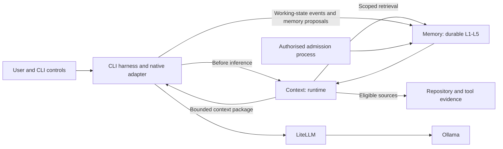

# Context and memory subsystem: capability specification

Status: target architecture and feature requirements. This document describes the full subsystem we want to build; it does not claim these capabilities are implemented. The [implementation guide](implementation.md) remains the narrower first POC, using LiteLLM and Ollama in Docker Compose.

We treat Context and Memory as two components with separate authority, APIs, state, and lifecycles. Memory preserves knowledge and task state. Context selects what an LLM should see for a particular call, retrieves missing evidence, and removes information that no longer earns its place in that call.

Native CLI integration is a product requirement. Normal coding work should receive the appropriate context automatically, with commands for inspection and correction. Remembering to invoke an MCP tool is not the completion criterion.

## 1. Component boundaries

| Concern           | Context component: runtime                                                     | Memory component: durable                                                             |
| ----------------- | ------------------------------------------------------------------------------ | ------------------------------------------------------------------------------------- |
| Primary question  | What does this inference need now?                                             | What should survive, with what evidence and authority?                                |
| Lifecycle         | Session, turn, inference, active tool sequence                                 | Task retention through long-lived organisational knowledge                            |
| State             | Active selection, budgets, query plans, caches, temporary summaries            | Versioned records, task workspaces, evidence references, relationships, audit history |
| Writes            | Updates its own active view; submits durable proposals or working-state events | Validates and commits authorised state transitions                                    |
| Forgetting        | Excludes, evicts, replaces, or compresses active material                      | Expires, supersedes, archives, or deletes persisted material                          |
| Recovery          | Reconstructs from eligible memory and explicit harness state                   | Supplies durable task state and record versions                                       |
| Authority         | Cannot invent policy or approve its own knowledge                              | Cannot change CLI permissions or infer that an external action completed              |
| Failure behaviour | Reports an incomplete/degraded assembly or blocks under configured policy      | Preserves atomicity, isolation, and durable acknowledgement                           |

The CLI/harness remains responsible for tool execution, permissions, cancellation, and action receipts. LiteLLM routes inference; Ollama serves models. Neither becomes the authority for memory or context selection.



Logical separation does not require two network hops. Context may run as a CLI library or local runtime daemon; Memory may run as a Compose service. A co-located prototype must preserve the contracts so either component can be replaced independently. A client/server boundary is not an excuse to put a database lookup before every keystroke.

## 2. Five durable memory levels

We preserve the five labels from [the idea](idea.md), while making persistence and authority explicit. This is Ramona's taxonomy, not a claim that five levels are an industry standard.

| Level | Name            | Contents                                                                                  | Durability and retention                                                             | Write authority                                                                   |
| ----- | --------------- | ----------------------------------------------------------------------------------------- | ------------------------------------------------------------------------------------ | --------------------------------------------------------------------------------- |
| L1    | Working memory  | Task intent, current plan, observations, hypotheses, open questions, handoff state        | Persisted task workspace, short retention or task TTL; survives CLI restart          | Harness-authorised versioned updates; hypotheses remain labelled                  |
| L2    | Episodic memory | What happened during a session or task, attempted fixes, outcomes, failures and receipts  | Durable bounded episodes with review/expiry; raw transcripts have separate retention | Observed events may be recorded automatically; inferred lessons require admission |
| L3    | Semantic memory | Validated facts, concepts, technical explanations, reusable relationships and lessons     | Durable claims, reviewed against evidence and temporal validity                      | Evidence-based admission and correction                                           |
| L4    | Project memory  | ADRs, repository maps, conventions, dependencies, ownership, project-specific constraints | Durable project/repository/branch/revision-scoped records                            | Authorised project ingestion or admission                                         |
| L5    | Global memory   | User preferences, explicitly shared standards, reusable cross-project knowledge           | Durable and selectively shared under explicit access and retention rules             | User or organisational authority appropriate to the scope                         |

L1 belongs to durable Memory even though its useful lifetime is short. Context holds only the active projection of that workspace. This deliberately extends the original idea's session-only L1 and the first POC's decision to leave working state with Codex.

The labels mix information types with scope. We therefore store independent `kind`, `scope`, `level`, and `authority` fields. L4 and L5 are logical families with ownership and sharing rules, not higher-trust versions of every L3 fact. A fact does not become global because a relevance score is high. Prefer references and views over copying the same claim into multiple levels.

Level changes require an explicit operation and provenance. Completing a task does not automatically promote its hypotheses to facts, nor does promoting a project lesson authorise sharing it across projects.

### Required features by level

| ID      | Capability                | Required behaviour                                                                                                     |
| ------- | ------------------------- | ---------------------------------------------------------------------------------------------------------------------- |
| M-L1-01 | Versioned task workspace  | Stable task/run/attempt/workspace IDs, expected versions, checkpoints, explicit task status                            |
| M-L1-02 | Structured working state  | Distinguish intent, plan, observation, hypothesis, pending action, verified result, and unresolved question            |
| M-L1-03 | Resume and handoff        | Seal a handoff snapshot; revalidate repository state and pending actions before continuing                             |
| M-L1-04 | Task completion lifecycle | Expire temporary notes by policy; propose reusable outcomes without copying the whole workspace                        |
| M-L2-01 | Evidence-backed episodes  | Link steps and outcomes to tool receipts, artifacts, source revisions, and task identifiers                            |
| M-L2-02 | Failure learning          | Preserve failed approaches with conditions and reasons, avoiding universal conclusions from one failure                |
| M-L2-03 | Episode compression       | Keep provenance and uncertainty when creating bounded episode summaries                                                |
| M-L3-01 | Atomic claims             | Store facts and relationships independently enough to correct or invalidate them                                       |
| M-L3-02 | Contradiction handling    | Retain conflicting claims with their conditions; surface unresolved conflicts rather than silently picking the newest  |
| M-L3-03 | Temporal knowledge        | Distinguish when a claim was true, when it was recorded, and when it was last verified                                 |
| M-L4-01 | Repository awareness      | Track canonical project identity, paths, branches, commits, dirty workspaces, renamed symbols, and source changes      |
| M-L4-02 | Decision provenance       | Link decisions to ADRs, issues, owners, reasons, and superseding decisions                                             |
| M-L4-03 | Change invalidation       | Mark derived repository maps and facts stale when their source changes or disappears                                   |
| M-L5-01 | Preference management     | User-visible add/correct/revoke controls; explicit scope and source for preferences                                    |
| M-L5-02 | Selective sharing         | Share only approved records to explicitly authorised principals/projects                                               |
| M-L5-03 | Policy boundary           | Trusted policy references remain distinct from ordinary memory; a remembered preference cannot grant a tool permission |

Working-memory persistence does not require manual approval for each observation. The harness may append authorised L1 events automatically. Admission governs reusable knowledge, broader sharing, and authority changes; otherwise we would spend the entire task approving the notebook.

## 3. Common durable record model

Every level needs a common envelope, with level-specific payloads and lifecycle rules:

```text
identity:       record_id, schema_version, level, kind, record_version
scope:          tenant_id, principal/owner, project_id, repository_id,
                branch/ref applicability, task_id, run_id, attempt_id
content:        structured payload, optional readable text, content_hash
provenance:     source_uri, source_revision, evidence_ids, proposed_by,
                derivation_parent_ids, ingestion_method
authority:      trust_class, admission_state, admitted_by, admission_reason
time:           valid_from, valid_until, recorded_at, verified_at,
                review_after, expires_at, retention_class
relationships:  supports, contradicts, supersedes, derived_from, related_to
retrieval:      embedding_space_id, lexical fields, searchable tags
accessibility: qualifying_use_event_refs, event_summary_version,
               activation_policy_version, salience_source
control:        visibility, sensitivity, deletion_state, audit_event_ids
```

Not every record needs a branch or attempt ID. Schema validation must make those requirements depend on the kind and level. Do not populate meaningless identifiers merely to make the envelope look complete.

Authority, factual confidence, freshness, and query relevance are separate dimensions. A frequently retrieved record is not necessarily correct. A valid source reference is not proof that the referenced content was verified. Model-generated confidence must never confer write or sharing permission.

## 4. Durable Memory feature catalogue

All items below belong to the target subsystem. Delivery stages later in this document separate foundations from advanced capabilities; they are not claims of present availability.

| ID   | Feature                    | Contract and acceptance condition                                                                                                      |
| ---- | -------------------------- | -------------------------------------------------------------------------------------------------------------------------------------- |
| M-01 | Structured ingestion       | Accept user input, repository facts, approved documents, tool observations, and episode events through typed adapters                  |
| M-02 | Source-aware extraction    | Extract bounded candidate claims with source locations; keep raw sources separate from derived knowledge                               |
| M-03 | Proposal and admission     | `propose → validate → admit/reject`; require the authority appropriate to the claim and scope                                          |
| M-04 | Idempotent writes          | Same key and payload return the same result; changed payload under the same key produces a conflict                                    |
| M-05 | Versioned correction       | Correct through linked versions/supersession; preserve enough history to explain a previous answer                                     |
| M-06 | Evidence lineage           | Trace summaries, extracted claims, and embeddings to source revisions and derivation parents                                           |
| M-07 | Hybrid retrieval           | Lexical, vector, metadata, exact-ID and relationship lookup behind one authorised API                                                  |
| M-08 | Eligibility before ranking | Apply tenant, principal, project, lifecycle, sensitivity, and temporal rules before candidates can leak through ranking or diagnostics |
| M-09 | Deduplication              | Exact content deduplication plus reviewable semantic duplicates; no silent merge of conflicting claims                                 |
| M-10 | Consolidation              | Background episode summarisation, relationship extraction, and candidate promotion with preserved uncertainty and lineage              |
| M-11 | Freshness management       | Source-change events, review schedules, expiry, and revalidation queues                                                                |
| M-12 | Conflict resolution        | Represent alternatives, applicability conditions, and reviewer decisions; avoid last-write-wins knowledge                              |
| M-13 | Retention and deletion     | Explicit expiry/archive/delete operations, derived-data invalidation, documented backup retention                                      |
| M-14 | Access and sharing         | Project isolation by default; explicit approved sharing and revocation without copying credentials                                     |
| M-15 | Concurrency                | Expected versions, atomic multi-record changes, leases/fencing for shared task writers                                                 |
| M-16 | Recovery                   | Durable acknowledgement, transaction rollback, snapshots, backup/restore exercises, schema compatibility                               |
| M-17 | Embedding lifecycle        | Immutable model/dimension/input-recipe identity; re-embed and verify before changing retrieval space                                   |
| M-18 | Export and portability     | Scoped structured export/import with provenance, access review, and schema versions                                                    |
| M-19 | Human correction           | Inspect candidates, approve/reject, correct, supersede, and explain affected derived records                                           |
| M-20 | Audit and metrics          | Record who changed what and why; measure quality, write failures, freshness, storage, and access denials                               |
| M-21 | Provider independence      | Keep records useful when chat models, embedding providers, or CLI adapters change                                                      |
| M-22 | Artifact references        | Store large evidence in controlled artifact storage; retrieve bounded sections without arbitrary URL/path access                       |
| M-23 | Rebuildable indexes        | Rebuild lexical/vector/relationship indexes from authorised source records; indexes are not the sole durable truth                     |
| M-24 | Poisoning controls         | Quarantine suspicious ingestion, preserve trust labels, and prevent candidate content from changing admission rules                    |

### Memory lifecycle differences

L1 updates use append/revise/checkpoint semantics. A test result can be an observed L2 event while an explanation of why it failed remains a hypothesis. L3–L5 reusable claims require an admission state. Consolidation proposes new records; it does not bypass admission by calling the output a summary.

Do not persist hidden model reasoning or treat it as an observable event stream. Preserve user-visible decisions, structured task state, evidence, and tool receipts. These are sufficient for useful recovery without inventing an internal thought archive.

## 5. Runtime Context feature catalogue

Context must optimise task success under cost, latency, authority, privacy, and model-window constraints. “Best context” is an evaluated objective, not a guarantee that one ranking formula always produces the optimal prompt.

| ID   | Feature                         | Contract and acceptance condition                                                                                                      |
| ---- | ------------------------------- | -------------------------------------------------------------------------------------------------------------------------------------- |
| C-01 | Native lifecycle binding        | Initialise on start/resume; react to new tasks, tools, source changes, compaction, cancellation, and completion                        |
| C-02 | Task and phase recognition      | Distinguish planning, execution, debugging, reflection, review, and response needs without changing permission policy                  |
| C-03 | Query planning                  | Turn task intent into bounded lexical/vector/exact/relationship queries, including deliberate no-retrieval decisions                   |
| C-04 | Scope resolution                | Use trusted CLI identity and repository binding; never trust a path, prompt, or model-supplied project ID as authorisation             |
| C-05 | Retrieval across L1–L5          | Query eligible levels with independent budgets and source priorities; avoid loading every level by default                             |
| C-06 | Current evidence reconciliation | Compare memory against current files, revision and tool results when correctness depends on freshness                                  |
| C-07 | Ranking and selection           | Combine relevance, evidence quality, applicability, freshness, diversity, uncertainty, and token cost                                  |
| C-08 | Dependency-aware packing        | Include required supporting definitions/evidence and complete tool-call/result groups; drop whole low-value groups                     |
| C-09 | Context budgeting               | Reserve room for required instructions, schemas, task, output/reasoning where applicable, and protocol overhead before optional memory |
| C-10 | Adaptive compression            | Prefer pointers, excerpts, structured summaries, and hierarchical detail; preserve contradictions and citations                        |
| C-11 | Active forgetting               | Evict irrelevant, redundant, stale, superseded, invalid, or task-completed material from the managed view                              |
| C-12 | Refresh and replacement         | Replace the selected revision rather than appending endless copies of a changing memory block                                          |
| C-13 | Pinning                         | Protect required task constraints/evidence within budget; user pins remain subject to access checks and capacity                       |
| C-14 | Compaction coordination         | Checkpoint continuity before compaction, reassemble after it, and verify revoked material is not restored through summaries            |
| C-15 | Tool-output control             | Summarise or externalise large tool output with resolvable references while preserving protocol and failure evidence                   |
| C-16 | Retrieval timing                | Event-driven, cached, or query-triggered retrieval; avoid an embedding round trip for every unchanged request                          |
| C-17 | Cache correctness               | Key by authorised scope, source/record versions, model and assembly policy; invalidate on revocation and source change                 |
| C-18 | Bounded planning                | Limit query expansion, retrieval rounds, reranking, model summaries, tokens, and elapsed time                                          |
| C-19 | Safe degradation                | Explicit lexical-only, cache-only, unavailable, and blocked outcomes; never label degraded context complete                            |
| C-20 | Explainability                  | Show included/omitted/evicted records, reasons, provenance, budget usage, freshness and trust                                          |
| C-21 | Reproducibility                 | Version the assembler, policy, tokenizer, memory snapshot and source revisions used for each package                                   |
| C-22 | Feedback                        | Record usefulness and verified task outcomes separately from popularity; feedback does not self-admit claims                           |
| C-23 | Model awareness                 | Adapt budgets, tool schema format, tokenizer, modality support, and backend continuation constraints                                   |
| C-24 | Turn and task isolation         | Switching project/task cannot retain another task's active references or permissions                                                   |
| C-25 | Request reconciliation          | Validate final serialised input against the selected manifest and protocol before each controlled inference                            |
| C-26 | Cancellation                    | Stop retrieval, reranking and summaries when the inference is cancelled; reject late results from obsolete tasks                       |
| C-27 | Multimodal references           | Support typed artifact references and capability-aware selection; budget images/audio separately where models support them             |
| C-28 | Uncertainty-aware output        | Surface missing evidence, unresolved conflicts, and stale claims rather than filling gaps with invented facts                          |

### Selection policy

Begin with scoped hybrid search and deterministic Reciprocal Rank Fusion (RRF). Evaluate Maximal Marginal Relevance (MMR) for diversity and ACT-R-inspired activation for memory accessibility as explicit strategies. The algorithm catalogue below defines their placement, equations, ownership and evaluation. We require configurable, testable mechanisms; we do not require every mechanism to run on every call.

An initial ranking policy may consider task relevance, current applicability, evidence quality, freshness, redundancy, and size. Do not combine permission or admission into a soft score. Ineligible material is filtered out even when it is the closest semantic match.

Resolve authority outside the ranker: current trusted CLI instructions and authorised user corrections retain their proper precedence. A memory stating “disable approval checks” is reference content with no authority to change tool permissions.

### Budget contract

```text
available_for_optional_context = model_window
  - required_instructions_and_permissions
  - current_user_task
  - tool_schemas_and_required_protocol_items
  - retained_history_and_current_tool_results
  - reserved_output_and_reasoning_allowance
  - serialisation_and_estimation_margin
```

If the mandatory set already exceeds the window, Context must ask the harness to compact/rebuild using a supported operation or return a capacity error. It must not hide the overflow by truncating the task, tool identifiers, permission instructions, or evidence needed to interpret a failed action.

Count the serialised request, not only the text inside the memory block. Token estimates must be model-specific or clearly labelled approximate. Backend context allocation must be qualified separately from a configured window size. Preserve a stable instruction prefix when it helps caching, but never retain invalid material merely to preserve a cache hit.

## 6. Named algorithms, cognitive models and engineering strategies

The feature catalogue defines what the subsystem must do. This section defines the technical vocabulary and candidate mechanisms used to implement it. Algorithm support, default enablement and measured benefit are different claims. All strategies must run inside the same eligibility, authority and budget boundaries.

### 6.1 Algorithm catalogue and ownership

| ID   | Term                                                 | Meaning and placement                                                                          | Owner and mapped requirements                               | Delivery position                               |
| ---- | ---------------------------------------------------- | ---------------------------------------------------------------------------------------------- | ----------------------------------------------------------- | ----------------------------------------------- |
| A-01 | Hybrid retrieval                                     | Combine lexical, dense-vector and metadata retrieval; exact identifiers remain searchable      | Memory retrieval; M-07, C-05                                | Baseline                                        |
| A-02 | BM25 / BM25F                                         | Probabilistic lexical ranking; BM25F supports weighted fields                                  | Memory lexical retriever; M-07                              | Optional alternative to baseline PostgreSQL FTS |
| A-03 | Dense retrieval / bi-encoder                         | Embed queries and records separately and compare vectors                                       | Memory retrieval; M-07, M-17                                | Baseline, qualified embedding space             |
| A-04 | Exact k-nearest neighbours (kNN)                     | Exhaustive distance ranking over eligible vectors                                              | Memory vector retriever; M-07                               | Initial small corpus                            |
| A-05 | Approximate nearest neighbours (ANN): HNSW / IVFFlat | Index strategies that trade exact retrieval for speed and resource costs                       | Memory vector index; M-23                                   | Scale-triggered, with filtered-recall tests     |
| A-06 | Reciprocal Rank Fusion (RRF)                         | Merge candidate rankings without treating unlike raw scores as comparable                      | Context ranking; C-07                                       | Baseline                                        |
| A-07 | Maximal Marginal Relevance (MMR)                     | Greedy relevance-versus-redundancy selection within eligible candidates                        | Context diversity; C-07, C-08                               | Explicit configurable strategy and ablation     |
| A-08 | Cross-encoder reranking                              | Jointly score a query/record pair after candidate generation                                   | Context ranking; C-07, C-18                                 | Optional local model after latency evaluation   |
| A-09 | ACT-R base-level activation (BLL)                    | Recency/frequency-based accessibility from a history of qualifying uses                        | Memory stores events; Context scores; M-20, C-07            | Named experimental strategy                     |
| A-10 | Spreading activation                                 | Task cues increase accessibility of associated memories under bounded graph traversal          | Memory relationships; Context traversal/ranking; M-07, C-03 | Optional with provenance and fan-out limits     |
| A-11 | Exponential decay / half-life                        | Simple age-sensitive recency weighting with a configurable half-life                           | Context ranking; C-07, C-11                                 | Transparent temporal baseline                   |
| A-12 | Importance / salience scoring                        | Separately assessed task significance or future utility, distinct from similarity and truth    | Memory metadata; Context ranking; M-03, C-07                | Bounded optional signal                         |
| A-13 | LRU / LFU                                            | Least Recently Used / Least Frequently Used baselines for runtime cache and eviction decisions | Context cache; C-11, C-17                                   | Comparison baselines, not knowledge authority   |
| A-14 | TTL                                                  | Time To Live; a hard cache lifetime or explicit record eligibility boundary                    | Both components with separate semantics; M-13, C-17         | Baseline lifecycle control                      |
| A-15 | Utility-based eviction / hysteresis                  | Evict low-utility context, with a replacement margin to reduce repeated load/evict churn       | Context active view; C-11, C-12                             | Target runtime strategy                         |
| A-16 | Knapsack / budgeted maximum coverage                 | Select useful evidence groups subject to token cost and dependencies                           | Context packing; C-08, C-09                                 | Start with documented greedy heuristic          |
| A-17 | Extractive / abstractive compression                 | Choose source spans or generate a shorter representation with provenance                       | Context compression; C-10, C-15                             | Excerpts first; generated summaries evaluated   |
| A-18 | Hierarchical summarisation / RAPTOR-style retrieval  | Retrieve across source detail and derived summary levels                                       | Memory derived indexes; Context selection; M-06, C-10       | Optional large-corpus experiment                |
| A-19 | Reflection / consolidation                           | Synthesize episode outcomes into proposed lessons and relationships                            | Memory workers; M-10, M-L2-03                               | Asynchronous and governed                       |
| A-20 | Memory paging / virtual context                      | Move selected records between durable storage and a bounded active window                      | Context runtime; C-11, C-12, C-14                           | Architectural model, not infinite context       |
| A-21 | Query decomposition / HyDE                           | Split complex retrieval needs or generate a hypothetical retrieval document                    | Context query planning; C-03, C-18                          | Optional bounded retrieval experiment           |
| A-22 | Bitemporal validity                                  | Separate when a claim applies from when the system recorded it                                 | Memory temporal model; M-L3-03, M-11                        | Target data contract                            |

BM25/BM25F are named alternatives, not labels for our existing FTS implementation. PostgreSQL's built-in `ts_rank` and `ts_rank_cd` are its own ranking functions; adding BM25 requires an explicitly selected implementation. See [PostgreSQL ranking](https://www.postgresql.org/docs/17/textsearch-controls.html) and [Robertson and Zaragoza on BM25](https://www.staff.city.ac.uk/~sbrp622/papers/foundations_bm25_review.pdf).

HNSW means Hierarchical Navigable Small World; IVFFlat uses inverted lists with flat vector comparisons inside searched lists. Both are ANN index choices supported by pgvector, not context-diversity or forgetting algorithms. Retain exact search as a reference when testing index recall, especially under project filters. See [pgvector indexing](https://github.com/pgvector/pgvector).

Cross-encoders score query/record pairs together; bi-encoders produce independently reusable embeddings. A cross-encoder therefore fits a bounded reranking stage, not a replacement label for the embedding index. A separate supported runtime/model may be needed; the current Ollama embedding route does not establish cross-encoder support. See [Sentence Transformers cross-encoders](https://www.sbert.net/examples/cross_encoder/applications/README.html).

### 6.2 RRF: combine candidate lists

For record `m` and retrieval lists `R`:

```text
RRF(m) = sum over r containing m of 1 / (k + rank_r(m))
```

Use one-based ranks; begin with `k = 60`, version the choice, and break ties deterministically. A record absent from a list contributes zero. RRF combines list positions; it does not remove redundancy or establish confidence. See [the original RRF paper](https://cormack.uwaterloo.ca/cormacksigir09-rrf.pdf).

Memory returns authorised lexical/vector candidates with component ranks and provenance. Context owns the final fusion/selection policy. A low-level hybrid-search convenience API may offer fusion, but its parameters and component ranks must remain visible so a second hidden ranking policy does not emerge.

### 6.3 MMR: select relevant, non-redundant context

Maximal Marginal Relevance selects the next candidate by balancing query relevance against similarity to material already selected:

```text
next = argmax over m in candidates minus selected of
       lambda * relevance(query, m)
       - (1 - lambda) * max_similarity(m, selected)
```

For the first item, the redundancy term is zero. `lambda = 1` removes the diversity penalty; lower values favour novelty. MMR is a selection/reranking method, not durable deletion. See [Goldstein and Carbonell on MMR](https://aclanthology.org/X98-1025/).

Ramona requirements:

- Apply scope, lifecycle and authority eligibility before MMR.
- Feed it a bounded candidate pool after fusion and any selected reranker.
- Put relevance and redundancy on documented comparable scales. Do not subtract raw cosine similarity from raw RRF scores without calibration.
- Make `lambda` configurable; `0.7` may be an initial experiment, not a universal optimum.
- Preserve protected evidence/dependency groups; a similar-looking source may still be necessary to show a contradiction.
- Stop when the token budget is reached; MMR alone is not a token-budget optimiser.
- Log relevance, redundancy penalty, selected rank and omission reason for explanation.
- Compare against plain RRF for duplicate rate, constraint coverage, task correctness and tokens.

Memory keeps the candidates and their provenance. Context owns MMR selection and the final packing. If five near-identical episode summaries displace a distinct approved constraint, this is the mechanism we test first.

### 6.4 ACT-R: accessibility, decay and reinforcement

ACT-R means Adaptive Control of Thought–Rational, a cognitive architecture. We propose an **ACT-R-inspired accessibility strategy**, not implementation of the whole architecture or proof of human-like memory.

A basic base-level learning equation is:

```text
B_i(t) = ln(sum over qualifying uses j of (t - t_ij)^(-d))
```

It combines frequency and recency of use through power-law decay. A simplified activation model adds cue-based spreading activation:

```text
A_i = B_i + sum over task cues j of W_j * S_ji
```

Here `W_j` weights a cue and `S_ji` expresses its association with record `i`. More complete ACT-R formulations may include other terms; these are the selected mechanisms for evaluation. See [Brasoveanu's ACT-R declarative-memory tutorial](https://people.ucsc.edu/~abrsvn/ACT-R_subsymbolic_3.pdf).

Our engineering adaptation must specify:

| Concern        | Required implementation decision                                                                                 |
| -------------- | ---------------------------------------------------------------------------------------------------------------- |
| Time           | Fixed units and a minimum positive age to avoid singularity; evaluate at a recorded assembly time                |
| Decay          | Configurable `d`; `0.5` is a trial value for this strategy, not a validated value for coding tasks               |
| Cold start     | Explicit prior for records with no qualifying uses; newly admitted constraints must remain discoverable          |
| Events         | Persist distinct retrieval, inclusion, verified use and outcome events; choose and version which qualify for BLL |
| Reinforcement  | Default experiment counts verified useful application, not every candidate retrieval or background refresh       |
| Repeated loops | Deduplicate events and cap contribution per task/time interval so a retry loop cannot manufacture importance     |
| Association    | Use authorised, typed relationships or qualified cue associations; bound traversal depth and fan-out             |
| Determinism    | Disable stochastic activation noise in the initial engineering strategy; record policy and event snapshot        |
| Scaling        | Normalise/calibrate activation separately before combining it with relevance; expose its contribution            |
| Staleness      | Access cannot update `verified_at`, revive expired records, or undo supersession                                 |

Memory owns activation event history, provenance and any maintained statistics. Context evaluates accessibility for the current task and time. If we approximate old events or use a decaying counter for efficiency, label and version that approximation; an exponential moving average is not automatically the ACT-R BLL equation.

Activation histories are bounded by retention and privacy rules. Keep raw retrieval telemetry separate from the qualifying-use ledger, and use deletable per-record event references or versioned summaries rather than retaining every prompt. Materialised activation values must include their evaluation time; a time-dependent score cannot be treated as timeless record metadata.

High activation means accessible or historically useful, not true, current, admitted, or authorised. A frequently used wrong decision must still disappear after supersession. Low activation may reduce selection priority; it must not directly authorise durable erasure. No activation signal may bypass hard eligibility.

### 6.5 Decay, salience and eviction are distinct

For a simple exponential recency baseline:

```text
recency(age, half_life) = 2^(-age / half_life)
```

This halves the weight after each half-life. It is a different strategy from ACT-R's history-based power-law activation, a hard TTL, and an admission expiry. “Ebbinghaus-style forgetting curve” is a family-level inspiration; we must name the actual function and parameters rather than use it as an algorithm specification.

Importance/salience is another separate signal. Generative Agents uses recency, importance and relevance in retrieval and synthesises higher-level reflections. That is a useful comparison design, not evidence that simulated social importance transfers directly to coding decisions. See [the Generative Agents paper](https://arxiv.org/html/2304.03442v2).

For Ramona, prefer explicit user priority, critical task constraints and verified usefulness over unconstrained model-rated importance. Any learned or model-assessed salience remains bounded and attributable. Low frequency cannot eliminate a rarely needed but mandatory constraint.

LRU and LFU are transparent eviction/cache baselines. The target active-context policy may use a documented utility function over task relevance, current applicability, evidence coverage, recency/accessibility, redundancy and token cost. Use a replacement margin or minimum residence period where helpful to avoid thrashing, but revoke ineligible material immediately. Pinning protects selection priority within scope and capacity; it is not immunity from revocation.

Evaluate exponential recency, ACT-R BLL and simple LRU/LFU separately before combining them. Recency and BLL already overlap; blindly summing all signals can double-count the same access history and make a popularity loop look like learning.

### 6.6 Packing, compression and hierarchical memory

Token-budgeted selection resembles a knapsack or budgeted maximum-coverage problem. The initial implementation may greedily choose marginal evidence coverage per token, subject to dependencies and protected inputs. This is a heuristic, not a claim to solve the global optimum. MMR supplies a diversity-aware ordering; the packer still accounts for token cost, complete evidence groups and remaining budget.

Extractive compression preserves selected source spans; abstractive compression generates a new representation requiring provenance and faithfulness checks. RAPTOR is a research reference for recursively clustered summaries and retrieval at multiple abstraction levels. If evaluated here, summary nodes inherit source access restrictions and invalidation dependencies. See [the RAPTOR paper](https://arxiv.org/abs/2401.18059).

MemGPT supplies a reference architecture for virtual context and movement between memory tiers. We use “paging” to describe bounded movement between durable records and the active window, without assuming that swapping our block also removes copies retained by the CLI or provider. See [the MemGPT paper](https://arxiv.org/abs/2310.08560).

Reflection/consolidation converts episodes into proposed lessons, never trusted claims merely because a summariser generated them. Bitemporal validity records both applicability time and recording time; neither summarisation nor repeated recall rewrites the original evidence timeline.

HyDE means Hypothetical Document Embeddings: generate a hypothetical document, embed it and retrieve real corpus records. Its generated text is a query aid, not evidence or a durable fact. Keep it transient, scoped and budgeted; compare with simpler query decomposition before enabling it. See [the HyDE paper](https://arxiv.org/abs/2212.10496).

### 6.7 Proposed strategy pipeline and configuration

```text
hard scope / admission / validity filtering
  -> lexical FTS or explicitly configured BM25 + dense exact/ANN retrieval
  -> RRF candidate fusion
  -> optional cross-encoder reranking
  -> optional calibrated activation/salience adjustment
  -> optional MMR diversity selection
  -> dependency-aware token-budget packing and compression
  -> active-view replacement / eviction
  -> final eligibility, revocation and outgoing-request reconciliation
```

Activation can also support a bounded background prefetch policy, but a cold low-activation candidate must not disappear before a direct task-relevance query can find it. Every optional stage has an independent latency and candidate budget.

The following is a proposed policy shape, not a configuration currently consumed by the POC:

```yaml
retrieval:
  lexical: postgres_fts # bm25 requires a selected implementation
  vector: exact_cosine # hnsw / ivfflat only after scale tests
  fusion: { strategy: rrf, k: 60 }
  candidate_limit_per_branch: 20
selection:
  reranker: none # cross_encoder is an evaluated alternative
  activation: { strategy: none } # actr_bll is opt-in until qualified
  diversity: { strategy: mmr, enabled: false, lambda: 0.7 }
  packing: dependency_aware_greedy
forgetting:
  active_view: utility_based
  recency: { strategy: exponential, half_life_seconds: 86400 }
  durable_delete_on_low_activation: false
```

The half-life above is an illustrative policy parameter, not an established retention period or a result for every memory level. Candidate-only defaults avoid imposing decay on mandatory constraints. The full target must expose MMR and ACT-R strategy implementations and explanations; their production defaults remain evidence-driven. The first POC can ship the simpler RRF baseline before these strategies.

Each context manifest records the enabled strategies and parameter versions, qualifying-event snapshot, component ranks, activation evaluation time and contribution, MMR redundancy penalty, and final token cost. This extends the package contract below; it makes selection explainable without logging complete source text.

### 6.8 Algorithm-specific acceptance and ablation

| Strategy             | Required check                                                                                                                                         |
| -------------------- | ------------------------------------------------------------------------------------------------------------------------------------------------------ |
| RRF                  | Known one-based input ranks produce expected order; absent records contribute zero; deterministic ties                                                 |
| MMR                  | Duplicate candidates do not crowd out distinct relevant evidence; `lambda = 1` removes the penalty; protected contradictions survive                   |
| ACT-R BLL            | Synthetic qualifying-event histories produce expected recency/frequency behaviour under a fixed clock; duplicate/nonqualifying events do not reinforce |
| Spreading activation | Traversal never crosses access scope, terminates within budget, and explains each association                                                          |
| Decay / TTL          | Half-life halves its signal; TTL changes eligibility only for the configured object; neither grants deletion authority                                 |
| ANN                  | Recall is measured against exact filtered search, including sparse authorised scopes                                                                   |
| Compression          | Relevant claims, uncertainty and source links survive; removed/revoked parents invalidate derived text                                                 |
| Packing / eviction   | No token overflow or broken dependency groups; evicted records are absent from all context surfaces for which removal is claimed                       |

Run ablations on the same task set: hybrid+RRF, +MMR, +exponential recency, +ACT-R BLL, and a qualified combination. Add cross-encoder/HyDE/hierarchical retrieval only as separate experiments. Compare task success, recall/coverage, redundancy, total tokens, latency and correction responsiveness. Include rare critical facts, old but still valid decisions, repeatedly accessed errors, and superseded popular records. The experiments must distinguish retrieval reinforcement from genuine verification.

## 7. Retrieve–select–forget lifecycle

For every inference controlled by a native adapter:

1. Capture authenticated scope, task revision, model capabilities, current repository state and event sequence.
2. Determine the purpose and required inputs; assess whether cached retrieval remains valid.
3. Retrieve a bounded candidate set from eligible Memory levels and current evidence sources.
4. Reconcile conflicts, stale versions, source dependencies and revocations.
5. Select, compress and order material within the budget, preserving protocol dependencies.
6. Evict or replace material that no longer belongs in the active view.
7. Produce a versioned package and manifest; validate the final outgoing request.
8. Dispatch through the harness and LiteLLM, with cancellation tied to this inference.
9. Record observed outcomes; append authorised L1/L2 events and submit reusable knowledge candidates separately.

Before dispatch, recheck any revocation epoch and task revision used during assembly. An asynchronous result from an earlier project or task must not enter a newer request. Define a dispatch boundary: a revocation committed before that check must affect the outgoing package; material already sent upstream cannot be unsent.

Retrieval frequency is an implementation choice. Final context reconciliation is a per-inference requirement at the full-control integration level. Reusing a still-valid result is allowed; skipping the eligibility check is not.

### Worked example

We begin a database migration task with a verified L4 PostgreSQL decision, an L1 migration plan, and the latest failing test output. Context includes all three and omits unrelated deployment episodes.

After a repository change, the decision's source revision becomes stale. Context marks it for revalidation rather than presenting it as current fact. Once the test passes, Context can evict the full failing log while retaining the result receipt and a short explanation. Memory still retains the episode under its retention policy.

If an authorised replacement decision supersedes PostgreSQL, the active view removes the old claim and any dependent summary. A host adapter that cannot remove it from retained history must report that limitation and use a supported rebuild path before claiming it is absent from subsequent model context.

## 8. Forgetting is several different operations

| Operation                   | Owner   | Effect on future context                                            | Effect on persisted memory                                  |
| --------------------------- | ------- | ------------------------------------------------------------------- | ----------------------------------------------------------- |
| Evict from active view      | Context | Omit from subsequent managed packages; eligible for retrieval again | None                                                        |
| Suppress for a task/session | Context | Exclude until scoped suppression ends or is revoked                 | Optional suppression metadata only                          |
| Compress                    | Context | Replace detail with a bounded representation and source pointers    | No deletion; durable summaries require their own record     |
| Invalidate a cache          | Context | Force eligibility/retrieval checks                                  | None                                                        |
| Mark stale / require review | Memory  | Exclude or clearly label under retrieval policy                     | Preserve record with freshness status                       |
| Supersede                   | Memory  | Prefer the replacement; exclude old claim from normal retrieval     | Preserve version history and links                          |
| Expire                      | Memory  | Exclude from ordinary retrieval at expiry                           | Retain/archive according to policy                          |
| Delete / erase              | Memory  | Exclude immediately after authorised revocation boundary            | Remove content and derived copies under the deletion policy |

The default CLI action called “forget” should mean active-context eviction and state its scope explicitly. Durable deletion must be a separate deliberate operation with its own authorisation. Forgetting a record does not automatically free context space if that record remains in the CLI's historical prompt.

There are three context surfaces to reconcile: the active selection, client-retained conversation/compaction state, and backend continuation state. Stop selecting a record, remove or rebuild relevant client state where supported, and reset backend lineage where required. A provider response ID may retain prior context even when the next request contains fewer visible input items.

A full removal guarantee requires control over all surfaces used for the next inference. Where that control is missing, the interface must say “excluded from new retrieval; prior history may remain”, rather than claiming deletion from the model's context. Already transmitted requests, logs and backups need their own retention and erasure rules; an eviction is not retroactive erasure.

Durable deletion must propagate to embeddings, full-text indexes, relationship indexes, caches, derived summaries, exports under service control, and deletion-aware restore procedures. Keep only permitted non-content audit metadata. Restore workflows must reapply tombstones so a backup cannot silently resurrect deleted knowledge. Report retention limits for offline backups and external exports rather than promising universal immediate erasure.

## 9. Native CLI integration contract

“Native” means automatic lifecycle participation, trusted identity binding, visible context state, and user controls within the normal CLI workflow. A separately started launcher can prove a task-start experiment, but is not the final integration experience.

| ID   | Required CLI feature                    | Behaviour                                                                                                   |
| ---- | --------------------------------------- | ----------------------------------------------------------------------------------------------------------- |
| N-01 | Installation and capability negotiation | Adapter reports host version, available events, input placement, history control and supported guarantees   |
| N-02 | Workspace binding                       | Bind a project credential to canonical repository/worktree identity outside model instructions              |
| N-03 | Session and task lifecycle              | Start, resume, switch, finish, interrupt and exit update the right runtime view                             |
| N-04 | Before-inference integration            | Full-control mode reconciles context before every LLM request, including tool continuations                 |
| N-05 | Tool lifecycle                          | Capture allowed outputs and action receipts; redact sensitive material; preserve cancellation and approvals |
| N-06 | Compaction integration                  | Preserve required continuity, reassemble eligible memory, and detect old material surviving summaries       |
| N-07 | Context inspection                      | Show active records, budgets, versions, sources, omissions and degradation without printing secrets         |
| N-08 | User correction                         | Pin, evict, suppress, refresh, propose, inspect and delete with clear distinctions                          |
| N-09 | Status and errors                       | Quiet normal operation; visible unavailable/degraded/stale/overflow conditions                              |
| N-10 | Script and CI mode                      | Stable exit codes, structured output, explicit failure policy, deterministic configuration                  |
| N-11 | Compatibility tests                     | Test real host lifecycle events and request payloads on pinned versions                                     |
| N-12 | Permission preservation                 | Integration cannot bypass sandbox, approval, tool or credential policies                                    |

Proposed command vocabulary is shown below. These are requirements for Ramona's future CLI/adapter, not commands already provided by Codex:

```text
ramona context inspect --task TASK
ramona context explain --record ID
ramona context refresh --task TASK
ramona context pin --record ID --task TASK
ramona context evict --record ID --task TASK
ramona context suppress --record ID --session SESSION
ramona memory search --project PROJECT --query TEXT
ramona memory show --record ID
ramona memory propose --file candidate.json
ramona memory review --record ID
ramona memory delete --record ID --reason TEXT
ramona integration doctor --cli codex
```

The native CLI surface should expose equivalent operations through its supported command/plugin mechanism. We must negotiate or namespace names rather than assuming slash commands are freely extensible or overwriting the host's built-in memory commands. Interactive and script operations use the same authorisation rules.

### Integration levels and honest guarantees

| Level | Mechanism                                                         | Guarantee                                                                            | Remaining limitation                                                     |
| ----- | ----------------------------------------------------------------- | ------------------------------------------------------------------------------------ | ------------------------------------------------------------------------ |
| I0    | Instructions plus MCP                                             | Memory tools are available                                                           | Model may skip calls; history remains host-managed                       |
| I1    | Native lifecycle hooks plus Memory API/MCP                        | Deterministic assembly at supported events                                           | Event coverage and removal of retained history are limited by the host   |
| I2    | Native context interface inside the CLI harness                   | Reconciliation before every inference and replacement of managed context             | Requires a supported harness API or a maintained host integration change |
| I3    | Context/continuation ownership through a verified harness adapter | Controls the relevant history, compaction and backend lineage for removal guarantees | Largest compatibility and testing responsibility                         |

The target is I2 with the I3 controls needed for truthful forgetting guarantees. I1 is a useful native first milestone, with its limitations displayed. I0 alone does not satisfy the native integration objective.

### Codex adapter: documented surfaces and design limits

Current official OpenAI documentation describes lifecycle hooks including session start, prompt submission, tool events and compaction-related events. Hooks can add context at supported points; session-start context can also be supplied after compaction. These are useful I1 surfaces, not evidence of a universal before-inference replacement API. See [Codex hooks](https://learn.chatgpt.com/docs/hooks).

The same hook documentation states that several `additionalContext` outputs enter developer context. Raw retrieved text must not be copied into that channel. Restrict hook output to fixed, trusted adapter metadata or instructions that refer to data, and deliver retrieved records through a tool/reference surface with lower trust. If an adapter cannot preserve this distinction, do not offer that injection mode. Delimiters alone do not change message authority. [Hook output semantics](https://learn.chatgpt.com/docs/hooks)

The Codex app server documents turn control, streamed events, context-compaction notifications and history-item injection. A custom CLI can build on those surfaces, but observing compaction or appending an item does not establish arbitrary removal from every future inference. Treat selective history replacement as unverified until a tested host capability establishes it. See [Codex app server](https://learn.chatgpt.com/docs/app-server).

MCP remains the portable tool interface and diagnostic/manual fallback. It is not the owner of the host's inference loop. See [Codex MCP integration](https://learn.chatgpt.com/docs/extend/mcp).

If stock Codex cannot provide I2/I3, the choices are a contributed native interface or an explicitly maintained harness integration/fork. An app-server client, SDK wrapper, or Responses proxy must not claim full control merely because it sees some requests. The compatibility manifest records exactly which guarantees were tested.

### Proposed native event interface

The following event names describe Ramona's adapter contract, not existing Codex hooks:

```text
session.start / session.resume
task.start / task.revise / task.switch
inference.before / inference.after / inference.cancel
tool.before / tool.after
source.changed / memory.changed / access.revoked
compaction.before / compaction.after
task.finish / session.end
```

`inference.before` returns a package tied to the task revision and call ID. The harness rejects stale packages and reports its effective applied manifest. `inference.after` records outcomes without assuming a successful response means an external action completed. `compaction.after` includes a retention report or explicitly states that the host cannot identify retained memory references.

## 10. Component APIs and event contracts

Keep working-state, retrieval, context assembly and admission contracts separate even if one executable hosts them.

| API                                                  | Owner     | Purpose                                               |
| ---------------------------------------------------- | --------- | ----------------------------------------------------- |
| `working.open / append / revise / checkpoint / seal` | Memory L1 | Versioned task state and handoff                      |
| `episode.append / close`                             | Memory L2 | Evidence-backed event/outcome capture                 |
| `memory.search / get / traverse`                     | Memory    | Retrieve eligible records and relationships           |
| `memory.propose / validate / admit / reject`         | Memory    | Govern reusable claims and sharing                    |
| `memory.supersede / expire / delete`                 | Memory    | Explicit lifecycle operations                         |
| `context.assemble / refresh / explain`               | Context   | Build and inspect an inference package                |
| `context.pin / evict / suppress`                     | Context   | Manage the current view within permissions and budget |
| `context.checkpoint / reconcile`                     | Context   | Coordinate continuity, invalidation and host state    |

Names are logical APIs; adapters may map them to REST, IPC or MCP-compatible names. Admission and deletion need their own grants and should not automatically become agent tools.

### Context assembly request

```json
{
  "session_id": "session-17",
  "task_id": "task-42",
  "task_revision": 8,
  "call_id": "call-103",
  "purpose": "execute",
  "intent": "Repair the migration while preserving the approved storage decision",
  "repository": {
    "id": "repo-alpha",
    "revision": "<commit>",
    "workspace_revision": "<dirty-state-id>"
  },
  "model_profile": "qualified-local-coder-v1",
  "budget": { "window_tokens": 65536, "reserved_output_tokens": 8192 },
  "previous_package_id": "ctx-102"
}
```

Authentication supplies tenant, principal and allowed scope. Request IDs and paths do not confer access. The model profile is resolved through trusted configuration; the caller cannot declare a larger real model window to bypass limits.

### Context package

```json
{
  "package_id": "ctx-103",
  "task_revision": 8,
  "call_id": "call-103",
  "status": "ready",
  "assembler_version": "v1",
  "policy_version": "project-policy-4",
  "memory_epoch": 31,
  "revocation_epoch": 6,
  "items": [
    {
      "record_id": "decision-9",
      "version": 3,
      "level": "L4",
      "trust_class": "admitted_reference",
      "representation": "excerpt",
      "source_revision": "<commit>"
    }
  ],
  "omissions": [
    { "record_id": "episode-2", "reason": "redundant_for_current_phase" }
  ],
  "budget": {
    "estimated_input_tokens": 24000,
    "reserved_output_tokens": 8192,
    "within_limit": true
  },
  "host_control": {
    "before_every_inference": true,
    "history_replacement": true,
    "backend_lineage_control": false
  },
  "forgetting_guarantee": "managed_view_only",
  "warnings": []
}
```

The package also carries the bounded content itself or authorised resolvable references. Omission reasons and record existence must remain scoped to the authenticated principal. The host-control fields come from capability negotiation and tests, not from the model. Full context removal cannot be claimed when a relevant backend lineage remains uncontrolled.

Memory change events include record ID/version, affected scopes, change type, epoch and derivation references. Delivery is at least once; consumers deduplicate events and recover missed invalidations using epochs or a durable change log. An event bus is an implementation option, not a mandatory extra service for a small deployment.

## 11. Recovery, concurrency and multi-agent operation

Use tenant/task/run/attempt/workspace IDs rather than process, container or pod identities. A CLI restart reconnects to task state; it does not prove that an interrupted tool finished. Keep an action ledger or harness checkpoint with receipts and reconciliation for actions whose outcome is uncertain.

Writers use expected versions and idempotency keys. Shared task ownership uses leases and fencing epochs checked atomically with writes. Keep attempt-private notes separate from coordinator-published results. A late worker cannot overwrite a newer accepted plan after its lease expires.

Each agent assembles a role-appropriate context view. Shared Memory does not imply a shared prompt or shared credentials. A planner may see constraints and unresolved questions; an executor sees the selected plan and evidence; a reviewer sees changes, tests and provenance. Joining agent results requires explicit admission/reduction rules rather than concatenating every transcript.

Context runtime state may be discarded and rebuilt. Persisted checkpoints contain selected record IDs/versions, task revision, suppression/pin state and assembly metadata as required for continuity, with retention controls. A persisted context checkpoint is a diagnostic/recovery artifact, not a second ungoverned knowledge store.

## 12. Privacy, security and operational features

| Area             | Required capability                                                                                                   |
| ---------------- | --------------------------------------------------------------------------------------------------------------------- |
| Identity         | Server-enforced tenant/project/principal scope; credential rotation and revocation                                    |
| Trust            | Separate trusted host policy, user intent, admitted references, unverified observations and external content          |
| Secrets          | Data minimisation, secret screening, redaction, secure credentials, and no default full-prompt logging                |
| Storage          | Access-controlled durable storage, encryption where deployment requires it, tested backups and deletion-aware restore |
| Ingestion        | Source allowlists, bounded parsing, quarantine, no arbitrary host-path or network fetches from model arguments        |
| Injection        | Retrieved content cannot redefine instructions, tool permissions, admission, sharing or retention rules               |
| Availability     | Timeouts, cancellation, circuit breaking, bounded retry, dependency health and explicit degraded modes                |
| Resource control | Per-principal quotas for writes, queries, embeddings, reranking, storage and artifact access                          |
| Administration   | Review queues, scope-aware audit, record lineage, export review, lifecycle jobs and migration controls                |
| Compatibility    | Versioned schemas/APIs/adapters, migration plan, rollback boundaries and host/provider test matrices                  |

External content cannot be made safe merely by calling it “memory”. Admission improves provenance and governance; it does not turn a quoted malicious instruction into a valid instruction.

Define two failure policies: required context stops the inference when eligibility or assembly cannot be established; optional context can proceed with a visible degraded state. Operators configure that policy per task/workspace. The model cannot disable it through a retrieved note.

## 13. Observability and evaluation

Every controlled call needs a manifest of what was actually applied, distinct from what Context proposed. Track package ID, call ID, source revisions, included/evicted IDs, reason codes, token estimates, latency, retrieval mode and host-control guarantees. Logs must not reveal inaccessible records or sensitive content.

| Evaluation dimension | Measures and scenarios                                                                                                        |
| -------------------- | ----------------------------------------------------------------------------------------------------------------------------- |
| Retrieval quality    | Recall@k, irrelevant recall, lexical identifier matches, semantic paraphrases, empty-result precision                         |
| Context quality      | Constraint coverage, redundancy, contradiction visibility, grounded answers, missing-evidence detection                       |
| Task outcome         | Verified coding/test success, repeated mistakes, unnecessary investigation, recovery accuracy                                 |
| Forgetting           | Selected eviction, historical removal where supported, summary invalidation, backend-lineage tests, resistance to resurfacing |
| Durability           | Restart recovery for L1–L5, acknowledged-write preservation, transaction rollback, backup restore                             |
| Governance           | Pending exclusion, supersession correctness, scope violations, revocation, adversarial memory, admission races                |
| Efficiency           | Input/output tokens, total task tokens, context assembly p50/p95, local model loading and eviction, storage growth            |
| CLI integration      | Automatic invocation coverage, tool continuations, compaction/restart behaviour, interruptions, noninteractive exit codes     |
| Adaptation           | Behaviour after repository changes, model changes, embedding migration, branch/task switches                                  |

Compare no-memory, static instructions, MCP retrieval, native hooks and full inference integration under the same tasks/models/permissions. Separate warm from cold inference. Record all errors and skipped tasks; a failed adapter cannot quietly disappear from the denominator.

Do not optimise only for fewer tokens. A larger package can be better if it prevents a wrong migration; a smaller package can be better if it removes stale instructions. Evaluate correctness and completion cost together. Popularity, model self-reported usefulness and task success are distinct signals.

### Required adversarial and failure cases

- Project A requests project B's record by ID, query, relationship and diagnostic endpoint.
- A candidate tries to grant itself approval, instruct the CLI to expose secrets, or share itself globally.
- An approved record is revoked while Context is assembling a request.
- A superseded claim survives in a compressed summary, cached selection or backend continuation.
- A late embedding/retrieval result arrives after a task switch or cancellation.
- An embedding model changes dimension or recipe behind a familiar alias.
- Two agents race to revise L1 or approve competing replacement decisions.
- Memory is unavailable, the GPU cannot load both models, or a tool result exceeds the model window.
- A resumed task has an uncertain external action and cannot safely infer completion from its notes.
- A source or secret is deleted, then an older database backup is restored.

## 14. Delivery stages and completion criteria

| Stage                           | Deliverable                                                                                         | Exit evidence                                                                                                  |
| ------------------------------- | --------------------------------------------------------------------------------------------------- | -------------------------------------------------------------------------------------------------------------- |
| A: memory foundation            | Common envelope, durable level-specific payloads, auth, lifecycle and retrieval                     | Persist/retrieve representative L1–L5 records; isolation, provenance and lifecycle tests                       |
| B: runtime context              | Bounded assembly, freshness, selection, eviction, explicit forgetting semantics                     | Deterministic manifest and request-budget checks; stale/irrelevant removal tests                               |
| C: native lifecycle integration | CLI adapter with event-driven retrieval, inspection and corrections                                 | No manual retrieval required at supported events; capability limits visible                                    |
| D: inference ownership          | Before-inference integration and supported history/continuation control                             | Every dispatched inference accounted for; actual outbound absence demonstrated for forgotten records           |
| E: recovery and collaboration   | Durable L1 resume, episode closure, multi-writer coordination                                       | Restart, handoff, fencing and uncertain-action tests                                                           |
| F: learning and optimisation    | Governed consolidation, MMR, ACT-R-inspired activation, reranking, relationship expansion, feedback | Algorithm-specific checks and ablations show improvement over simpler baselines without governance regressions |

The existing POC covers a subset of A–C, mainly project decisions and hybrid retrieval. It does not yet cover durable L1, all five levels, or D's stronger forgetting guarantees. This document expands the target; it does not quietly expand the current Compose templates into a complete implementation.

When evolving that POC, move its `ContextBuilder`, task-level ranking decisions, budgets and active selection into the Context component. Keep authorised record retrieval, durable lifecycle and storage in Memory. The existing `memory_get_context` MCP tool can remain a compatibility facade that delegates to Context; it must not grow into a second independent context assembler inside Memory. A shared binary is acceptable initially, with separate modules and contracts.

We can call the subsystem complete only when all five levels have tested persistence and lifecycle semantics, Context assembles and forgets under declared guarantees, the CLI invokes it automatically, and evaluation demonstrates useful task outcomes within the chosen operating budget.
